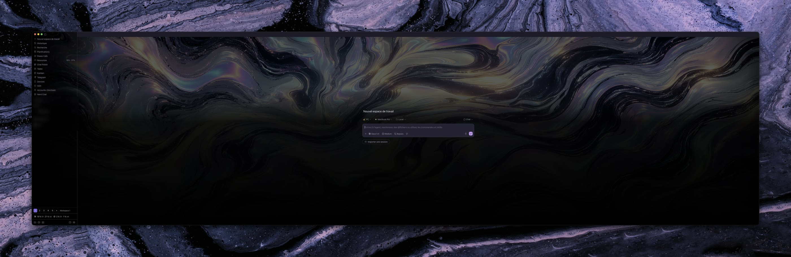
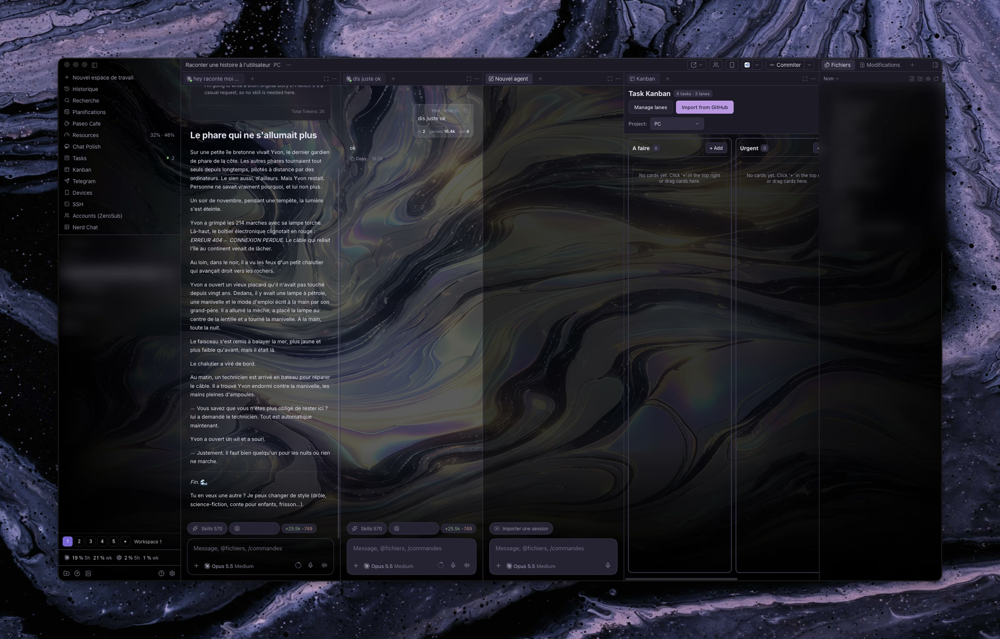
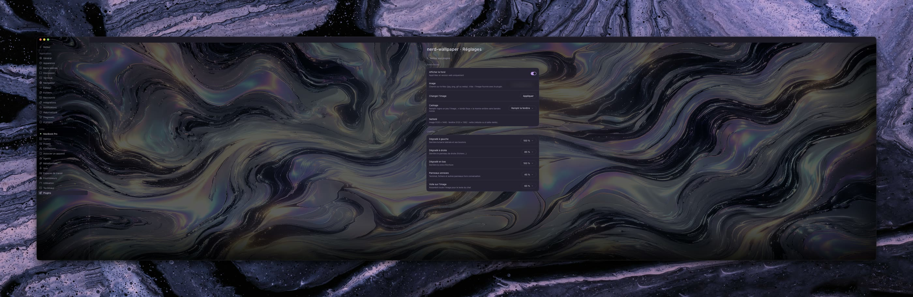

<div align="center">

# 🖼️ App Wallpaper

**Give Paseo a real wallpaper — and keep every button, message and panel readable.**

[](LICENSE)
[](https://paseo.sh)
[](#requirements)



</div>

App Wallpaper is a [Paseo](https://paseo.sh) plugin that puts any image — photo, artwork, animated GIF —
behind the whole app. Instead of baking shadows into your picture, it lays smart, adjustable layers on
top: gradients that follow the real size of the sidebar, the composer and the side panels, plus a veil
for long chats. Swap the image whenever you like; the readability stays.

## ✨ Features

- **Any image, untouched** — JPG, PNG, WebP or animated GIF, up to 20 MB. The file is never edited.
- **Layout-aware gradients** — left, right and bottom gradients sized to the *actual* sidebar,
  right panel and composer, and they follow you when you resize them.
- **Readable everywhere** — a global veil for chat text, and a separate veil for side panels
  (terminal, files, Kanban…). Chats stay clear so the image shows through.
- **Three fit modes** — *Fill window*, *Whole image with blurred edges* (no black bars, ever),
  or *Whole image with black bars*.
- **Sharpness check** — tells you live whether your image is downscaled (sharp) or stretched (blurry),
  and the minimum size to aim for.
- **Ultrawide-ready** — built and tested on a 5120 × 1440 (32:9) monitor.
- **One click away** — an *App Wallpaper* entry in the sidebar opens the settings.

## 📸 Screenshots

| Chats, Kanban and side panels | Settings |
| --- | --- |
|  |  |

## 🚀 Getting started

### Requirements

- **Paseo 0.15.2 or later**, with plugins enabled: *Settings → Plugins → Enable plugins*.
- The **desktop app** (macOS; Windows and Linux use the same app but are untested) or the **web app**.
- The iOS and Android apps are native and have no page to restyle: the plugin does nothing there.

### Install

```bash
paseo plugin add git:Areb-AL/paseo-app-wallpaper
paseo plugin ls            # app-wallpaper should be "running"
```

You can also paste `git:Areb-AL/paseo-app-wallpaper` into *Settings → Plugins → Plugin source*.
While the repository is private, the machine running the Paseo daemon needs Git access to it.

### Update and uninstall

```bash
paseo plugin update app-wallpaper
paseo plugin remove app-wallpaper   # also deletes its settings
```

## 🎛️ Usage

Open **App Wallpaper** in the sidebar (or *Settings → Plugins → App Wallpaper*).

| Setting | What it does |
| --- | --- |
| **Show wallpaper** | Turns the plugin on or off. |
| **Image** | Path to an image on the daemon host, e.g. `~/Pictures/wallpaper.jpg`, then **Apply**. Leave empty for the bundled `assets/default-5120x1440.jpg` (procedural violet halftone clouds). |
| **Fit** | *Fill window* (crops a little), *Whole image, blurred edges*, or *Whole image, black bars*. |
| **Sharpness** | Image size vs. window size, with a warning when the image is stretched. |
| **Left / Right / Bottom gradient** | Strength of each gradient, from none to 100 %. |
| **Side panels** | Veil on non-chat panels (terminal, files…). |
| **Image veil** | Darkens the whole image so chat text stays legible. |

### Pick an image that stays sharp

Use an image **at least as large as your window**, in landscape:

| Screen | Aim for |
| --- | --- |
| 1080p | 1920 × 1080 |
| 1440p / MacBook | 2560 × 1440 or more |
| 4K | 3840 × 2160 |
| 49" 32:9 (e.g. Samsung Odyssey G9) | 5120 × 1440 |

Smaller images get stretched and look blurry.

## 🤝 Works well with

- **[Chat Polish](https://github.com/lthieu96/paseo-chat-polish)** by [@lthieu96](https://github.com/lthieu96)
  (`paseo plugin add lthieu96/chat-polish`) — redraws the chat timeline as one clean column and
  lets you build a custom theme with live contrast checks. App Wallpaper paints the background,
  Chat Polish polishes what sits on top: a dark theme whose **raised** and **control** colors
  match your wallpaper makes message cards and the composer blend in. Its themes also apply on
  iOS and Android, where App Wallpaper cannot draw.

Both plugins restyle Paseo's own interface and are designed to run side by side. App Wallpaper
is an independent project, not affiliated with Chat Polish.

## ⚙️ How it works

- `server/background.ts` reads the settings, loads the image from disk and sends it to the app.
- `client/web.ts` adds a `<style>` tag: the image and the gradients become the page background.
  Images are passed as a Blob URL, because Chromium rejects data URLs over 2 MB.
- A `MutationObserver` finds large layout blocks with an opaque background and makes them transparent.
  Large panels that are not a chat get the side-panel veil. Dialogs, menus, message cards and the
  composer keep their own background.
- Settings are stored by Paseo on the daemon host (`defineSettings`) and shared by every connected app.


## ⚠️ Limitations

- Paseo has no official wallpaper API. The plugin relies on Paseo's `data-testid` markers
  (`left-sidebar-resize-handle`, `message-input-root`, `agent-chat-scroll`…), which are not a public
  API: a Paseo update can break it.
- No effect on the iOS and Android apps.
- The settings screen is in French for now.
- The image path is read on the machine running the Paseo daemon, not on the device you are using.

## 🩺 Troubleshooting

| Problem | Fix |
| --- | --- |
| Nothing changes | Check `paseo plugin ls` shows `running`, then reload the app (⌘R / Ctrl+R). |
| Wallpaper missing | The settings show *Image introuvable* (image not found) with the reason; `paseo plugin logs app-wallpaper` has details. |
| Blurry image | Look at **Sharpness** and use a larger image. |
| Black bars | Switch **Fit** to *Fill window* or *Whole image, blurred edges*. |
| Text hard to read | Raise **Image veil** to 65–85 %. |

## 🛠️ Development

```bash
npm install                     # type definitions only
npm run typecheck
paseo plugin install "$PWD"
paseo plugin reload app-wallpaper
paseo plugin logs app-wallpaper
```

Plugin docs: <https://paseo.sh/docs/plugins>

## 🗺️ Roadmap

- Focus mode: blur the wallpaper on screens without a chat (settings, plugin pages).
- Gentle animated wallpapers.
- Frosted glass behind the chat column.

## 🤝 Contributing

Issues and pull requests are welcome. Please describe your Paseo version and platform, and attach a
screenshot when something looks wrong.

## 📄 License

[MIT](LICENSE) © Areb ([@Areb-AL](https://github.com/Areb-AL))
